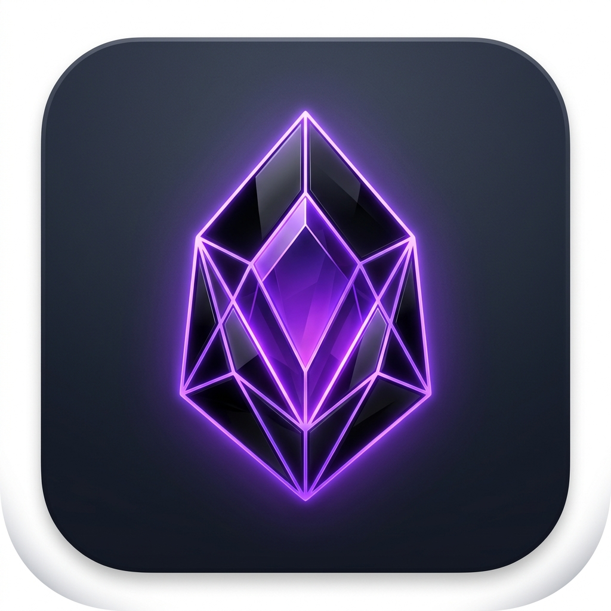

# 💎 Gosidian

<p align="center">
  
</p>

<p align="center">
  <strong>High-performance, local-first Obsidian clone built with MyGo (pure Go desktop runtime) & TypeScript.</strong>
</p>

<p align="center">
  
</p>

---

## ✨ Features

- **⚡ Blazing Native Performance**: Powered by a pure Go backend (`github.com/egoist/mygo`) running native Windows APIs with zero cloud tracking and full local privacy.
- **🎨 Obsidian Dark Theme**: Faithful Obsidian UI styling with signature violet/purple accents, collapsible sidebars, ribbon, tab bar, status bar, and resizable split panes.
- **📁 First-Run Vault Selector**: Choose where your vault lives on first launch (Documents, an existing folder, or create a new vault). Automatically creates a clean `Welcome to Gosidian.md` starter note.
- **📊 Pele Diagram Engine**: Native ultra-fast SVG diagram generator supporting flowcharts (`flowchart LR`, `flowchart TD`) and sequence diagrams (`sequenceDiagram`).
- **📐 KaTeX LaTeX Mathematics**: Real-time inline (`$...$`) and block (`$$...$$`) math formula rendering.
- **🌐 Interactive Knowledge Graph**: Dynamic force-directed spring and Coulomb physics graph visualization (`Ctrl+G`) mapping your notes and `[[WikiLinks]]`.
- **🎨 Infinite 2D Spatial Canvas**: Visual thought mapping on infinite pannable and zoomable spatial canvas (`.canvas` files).
- **🕰️ Local Snapshot Version History**: Automatic background snapshot saving to `.gosidian/recovery` with instant diff preview and one-click rollback.
- **⌨️ Command Palette & Hotkeys**: Fuzzy searchable command palette (`Ctrl+P`), customizable hotkeys modal, quick search (`Ctrl+Shift+F`), and split views (`Ctrl+\`).
- **🗂️ Markdown & Obsidian Callouts**: Support for YAML frontmatter properties, checklists, task toggles, tables, footnotes, and callout blocks (`> [!NOTE]`, `> [!TIP]`, `> [!WARNING]`, etc.).

---

## 🚀 Getting Started

### Prerequisites

- [Go 1.22+](https://go.dev/)
- [Node.js 20+](https://nodejs.org/)

### Installation & Development

```bash
# Clone the repository
git clone https://github.com/alvyn16/GOsidian.git
cd GOsidian

# Install dependencies
npm install

# Run in development mode (launches desktop window with hot module reloading)
npm run dev
```

### Running Tests

```bash
# Run both Markdown unit tests and Go backend test suites
npm test
```

### Production Build

```bash
# Build desktop packages (portable executable & NSIS setup installer)
npm run build
```

Compiled outputs will be located in `build/windows-amd64/`:
- **Setup Wizard**: `gosidian Setup 1.0.0 amd64.exe` (NSIS installer with desktop & start menu shortcuts)
- **Portable App**: `gosidian.exe` (Standalone portable executable, runs anywhere without installation)

---

## 🛠️ Architecture

Gosidian bridges a Go backend with a modern TypeScript frontend:

```pele
flowchart LR
    A[Vite + TypeScript UI] <-->|MyGo IPC Bridge| B[Go Backend Service]
    B <--> C[Local Markdown Vault]
    B <--> D[Local Snapshot Recovery]
```

- **Backend (`main.go`)**: File system operations, fuzzy search, graph topology indexer, recovery snapshot engine, native OS folder selector.
- **Frontend (`src/`)**: Tab management, CodeMirror / Live-preview editor, Pele diagram engine, KaTeX math renderer, Force-directed graph canvas.

---

## 📜 License

MIT License. See [LICENSE](LICENSE) for details.
